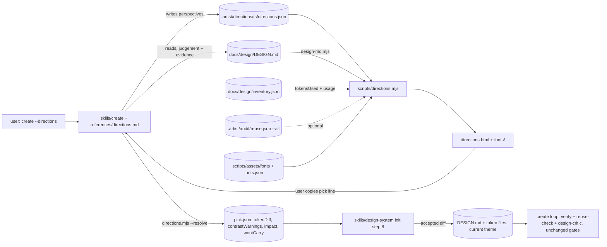
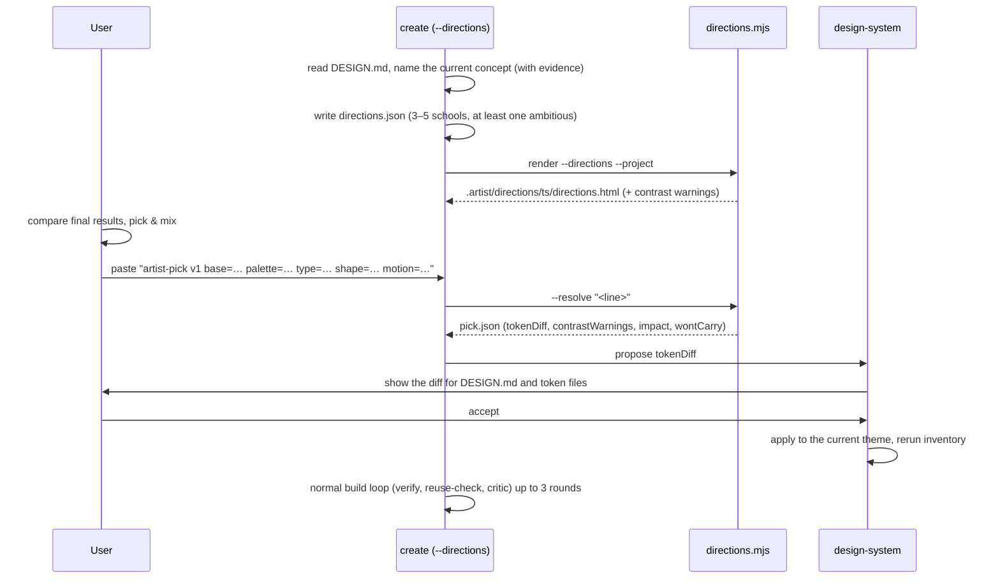

> **Human reference.** The loop never reads this file. What it enforces lives in
> [`directions.rules.md`](./directions.rules.md); if the two disagree, the rules file wins
> and `/architect --update directions` should be run.

# Directions architecture
_Last verified: 2026-10-28 at `a282119` · Source idea: [design-directions](../ideas/design-directions.md)_

## In plain English
`create --directions` adds one optional step before artist builds anything.
Claude names the project's current design concept, citing evidence. It then
writes three to five contrasting directions, each taken from a fixed list of
ten design schools, and at least one of them is deliberately ambitious. Each
direction is only a set of token values: colours (light and dark), type,
shape and depth, motion, and density.

A script, `scripts/directions.mjs`, turns those values into one offline HTML
page that shows each direction as a finished sample screen next to the
current design. On that page you can pick a base direction and then take
palette, type, shape and motion from any direction, with a live preview. The
page also shows the token diff and every component and file the change would
reach.

You copy a short pick line back into chat. The script checks it and writes
`pick.json`. `design-system` applies the pick once to the current theme, so
the same component changes the same way on every page. `create` then builds
through its normal measured loop.

## How it fits

## Decisions
| id | decision | why | rejected alternatives |
|---|---|---|---|
| ARCH-DIRECTIONS-01 | Opt-in `create --directions`, procedure in a reference pack | ARCH-PLUGIN-07 fixes four skills, and the default flow stays untouched | a new `explore` skill (needs an amendment); offering it on every new page; always on (cost) |
| ARCH-DIRECTIONS-02 | Fixed ten schools in a `SCHOOLS` constant, mirrored in directions.md | the user ruled out custom schools; one owner plus a test stops the list drifting | free-form styles; an opt-in UI/UX Pro catalogue as the source |
| ARCH-DIRECTIONS-03 | Current plus 3–5 directions, distinct, at least one ambitious, written in-session | homogenisation research says to present contrasting alternatives; one agent and one critic per round (ARCH-PLUGIN-09/10) | a council of agents (blocked on root-only hosts, N× cost); a critic call per direction |
| ARCH-DIRECTIONS-04 | Current values come from DESIGN.md via design-md.mjs; the concept name is a judgement | numbers and values come from scripts (ARCH-VERIFY-18) | the model retyping current tokens; an automatic style classifier (no reliable method found) |
| ARCH-DIRECTIONS-05 | directions.json maps existing or proposed token names, light and dark | a pick must land as a theme diff (ARCH-PLUGIN-35), and markup cannot be mixed | directions as generated HTML; layout as a mixable axis |
| ARCH-DIRECTIONS-06 | One script renders a fixed sample screen in three views | deterministic, testable, about 1× cost, no app build | N real page builds (0xdesign-style); a temporary dev route; a canvas tool |
| ARCH-DIRECTIONS-07 | _Superseded by ARCH-DIRECTIONS-15_ | | |
| ARCH-DIRECTIONS-08 | Contrast is computed and warns, never blocks | user choice; axe in the create loop still gates the built result | blocking the render until fixed |
| ARCH-DIRECTIONS-09 | The pick comes back as a validated pick line → `pick.json` | ids only, so pasted text cannot inject values; rebuilt deterministically | a downloaded pick.json; both line and download; a local server |
| ARCH-DIRECTIONS-10 | Applied once to the current theme by design-system (init step 8) | project-wide carry-over by variables, one owner of DESIGN.md (ARCH-PLUGIN-14/38) | a new `data-brand` theme per pick; editing per page |
| ARCH-DIRECTIONS-11 | Impact from the inventory join; "won't carry" only from reuse.json | existing deterministic data; findings come only from reuse-check (ARCH-VERIFY-18) | the model listing affected files; grepping in the renderer |
| ARCH-DIRECTIONS-12 | Bundled OFL woff2 fonts with a sha-pinned manifest | no network allowed; real typefaces make the type axis judgeable | a Google Fonts exception; system fallbacks only |
| ARCH-DIRECTIONS-13 | node --test suite plus a create eval case | repo convention (ARCH-VERIFY-11, ARCH-PLUGIN-20) | manual checks |
| ARCH-DIRECTIONS-14 | Starts after component_token_literals and skill-create-optimise (met); component formats inventory cannot parse (`.svelte`, `.astro`, `.marko`, `.riot`), found by a bounded project walk, show impact as unsupported, never zero | the "won't carry across" list depends on it, and they share SKILL.md files; inventory never lists those files, so only a walk can see them | starting in parallel (merge conflicts, an empty warning list); trusting inventory contents alone (the unsupported branch never fired) |
| ARCH-DIRECTIONS-15 | Self-contained page, strict CSP, escaping, CSS value grammar that names every accepted form (rgba/hsla, `deg`, bare numbers, `cubic-bezier()`, easing keywords, `inset`) | token values are untrusted, and a style attribute is an injection sink; motion, type and shape tokens need these safe forms, and the rule must match the code | allowing arbitrary CSS strings; a page with no script (pick & mix needs JS); keeping the shorter 07 list (rule and code disagree) |

Inherited and unchanged: ARCH-PLUGIN-07/09/10/11 (skills, agent, critic),
ARCH-PLUGIN-14/38 (only design-system writes DESIGN.md and token files, after
you accept a diff), ARCH-PLUGIN-24/28 (the stop condition and motion rules
apply to the ambitious pick too), ARCH-PLUGIN-35 (Themes, light and dark),
ARCH-VERIFY-11/18/23 (test runner, numbers from scripts, inventory schema).
ARCH-DIRECTIONS-07 is amended by ARCH-DIRECTIONS-15 (2026-10-28, after review round 1).

## Data & flows

Ownership: `directions.json`, `directions.html` and `pick.json` are run
artefacts under `.artist/directions/<ts>/`, in the folder design-system offers
to gitignore. DESIGN.md and the token files stay design-system's alone.

## Trade-offs & known limits
- The sample screen is representative, not your real pages. You see the pick
  on real pages in the first `create` round after it is applied. Rendering
  directions on real pages (as candidate `data-brand` themes) is deferred
  until there is evidence people want it.
- Only token axes can be mixed. Layout density and component treatment come
  from the base direction and are limited to token-expressible values.
  Structural layout changes are still `create`'s job.
- Contrast warnings don't block, so a low-contrast pick can reach `create`,
  where axe fails it and the loop spends rounds fixing it.
- Bundled fonts add about 1.5 MB to the plugin and need their licence files
  and sha256 kept current.
- The impact list is only as good as the inventory (Vue/Nuxt included).
  Svelte, Astro, Marko and Riot components are found by a bounded walk of the
  project and marked unsupported instead of showing zero.
- Contrast is not computed for gradient or `var()` values; the page shows a
  "not checked" badge for those pairs instead of an all-pass note.
- React Native projects get a web approximation of their theme.

## Glossary
- **School**: one of the ten fixed design styles a direction starts from.
- **Ambitious school**: glassmorphism, retro-futurist or aurora, the
  "showcase" slot, held to the same gates.
- **Direction**: a school adapted to the project, written as token values per
  axis.
- **Axis**: palette, type, shape & depth, motion (mixable); base (not
  mixable).
- **Pick line**: the one-line `artist-pick v1 …` record copied from the page
  back into chat.
- **Won't carry across**: a component that hard-codes values instead of using
  tokens, so it won't follow the pick.
