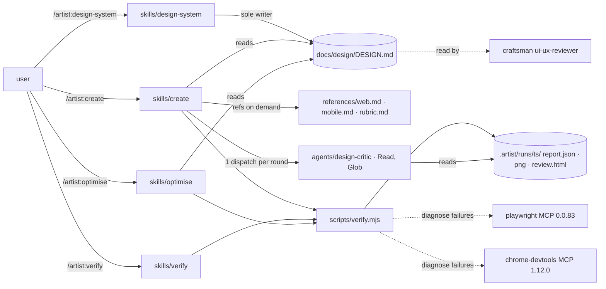
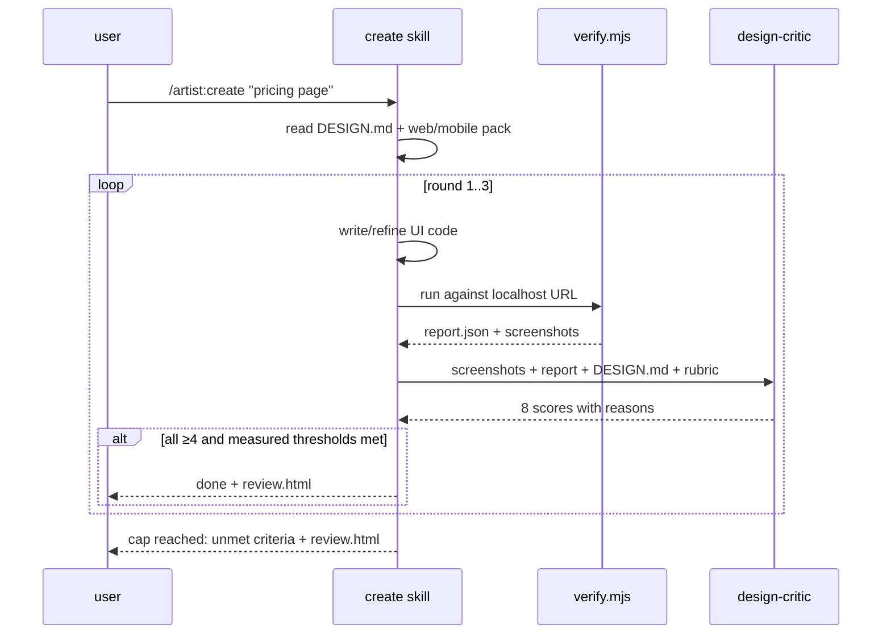

> **Human reference.** The loop never reads this file. What it enforces lives in
> [`plugin.rules.md`](./plugin.rules.md); if the two disagree, the rules file wins
> and `/architect --update plugin` should be run.

# Plugin architecture
_Last verified: 2026-10-25 at `38431ca` · Source idea: [artist-ui-plugin](../ideas/artist-ui-plugin.md)_

## In plain English
Artist is a Claude Code plugin that designs, builds and polishes UI for web
(React/Next.js/Tailwind) and mobile (Expo/React Native) projects. It differs from
using Anthropic's `frontend-design` skill plus Playwright on their own in three
ways:
- **A project design system.** It records one in `docs/design/DESIGN.md`.
- **It refines.** It renders what it built, has an isolated critic score the
  screenshots against a fixed eight-point rubric, and refines until every score
  is at least 4/5 (at most 3 rounds).
- **It measures.** Accessibility and Core Web Vitals come from a deterministic
  script, not from the model's impression.

It is made only of skills and one read-only agent, with no hooks. It runs on its
own and inside craftsman projects without tripping craftsman's guards.

## How it fits

## Decisions
| id | decision | why | rejected alternatives |
|---|---|---|---|
| ARCH-PLUGIN-01 | Skills only, no `commands/` | official guidance prefers skills for new plugins | flat commands |
| ARCH-PLUGIN-02 | No hooks in v1 | cannot collide with craftsman's PreToolUse/PostToolUse guards | format/lint hooks |
| ARCH-PLUGIN-03 | No dependency on craftsman | owner requirement: independent | declare `dependencies` |
| ARCH-PLUGIN-04/05 | Two pinned MCPs, headless, isolated, telemetry off | owner chose thin core; supply-chain and token cost | bundling all 16 |
| ARCH-PLUGIN-06 | Keys only via sensitive `userConfig` | keeps secrets out of files | env vars in `.mcp.json` |
| ARCH-PLUGIN-07/08 | Four workflow skills plus web/mobile reference packs | owner chose web and mobile from day one; packs load only when needed | one giant skill; separate mobile plugin |
| ARCH-PLUGIN-09/10/11 | Isolated read-only critic, one per round, NOT ISOLATED fallback | reduces self-grading bias; passes craftsman's guard via a `builtinAgents` line | in-session self-critique |
| ARCH-PLUGIN-12/24 | Fixed 8-dimension rubric; stop at all ≥4 + axe 0 serious + LCP ≤2.5 s + CLS ≤0.1 + 0 unjustified new components/layouts/colours, max 3 rounds (24 supersedes 13) | owner chose this bar; turns "great" into something checkable | avg ≥4.5 with 5 rounds; avg ≥3.5 with 2 rounds |
| ARCH-PLUGIN-14/22 | `design-system` is sole writer of DESIGN.md, which now inventories Components and Layouts (name, path, use) beside the colour tokens (22 supersedes 15) | one source of truth shared with craftsman's reviewer; reuse needs a list to check against | every skill edits tokens |
| ARCH-PLUGIN-23 | Reuse existing components, layouts, colours and installed npm packages (e.g. chart.js) wherever they fit; anything new, including a new dependency, needs a one-line justification (23 supersedes 16) | owner asked that the AI use what exists, within reason; the justification is the "within reason" | prose instructions plus critic only; advisory-only check |
| ARCH-PLUGIN-17 | Page content is untrusted data | prompt-injection via rendered pages | — |
| ARCH-PLUGIN-18 | `optimise` limited to measured perf/a11y plus UI-level security smells | craftsman already has security/dependency auditors | a second security auditor |
| ARCH-PLUGIN-19 | Own marketplace in this repo | independence from craftsman releases | add to craftsman-marketplace |
| ARCH-PLUGIN-20 | `validate --strict` plus evals per skill | catches manifest drift; regression net | manual testing |
| ARCH-PLUGIN-21 | Other 7 integrations as README snippets | opt-in per project, nothing runs by default | bundling |

## Data & flows

**Cross-repo work (craftsman, planned as a separate project step):**
`agents/ui-ux-reviewer.md` and `skills/design-review/SKILL.md` load
`docs/design/DESIGN.md` when present. `EXTENDING.md` documents adding
`"artist:design-critic"` to `execution.builtinAgents`. No guard code changes.

## Trade-offs & known limits
- **Mobile verification.** The browser only sees mobile screens through Expo web.
  Native-only screens get guidance and critique of manual screenshots, not
  measurements.
- **Cost per page.** Three rounds roughly triples the cost of a single pass.
  Revisit the cap if pages routinely need all three.
- **Pinned MCPs drift stale.** Bump them deliberately, with an eval run.
- **Critic in craftsman projects.** It needs one config line there. Without it,
  rounds run NOT ISOLATED.

## Glossary
- **Round**: one build → measure → critique pass.
- **NOT ISOLATED**: the critique ran in the building session, not a fresh agent.
- **CWV**: Core Web Vitals (LCP, CLS).
- **Token**: a named design value (colour, size, spacing) in DESIGN.md.
