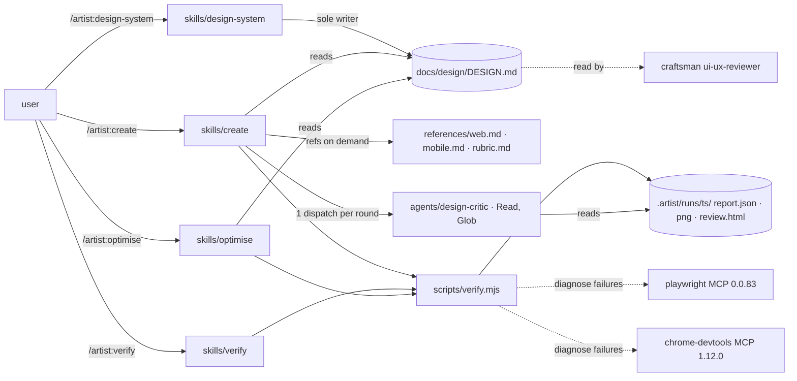
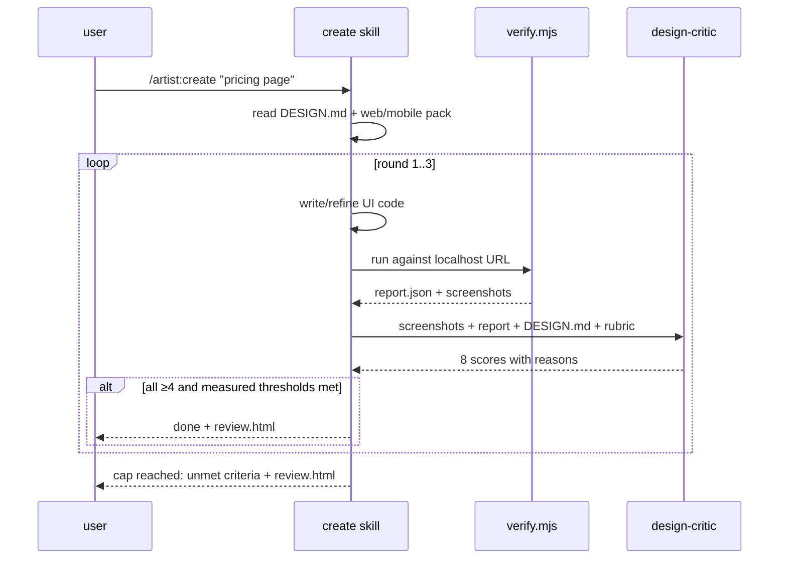
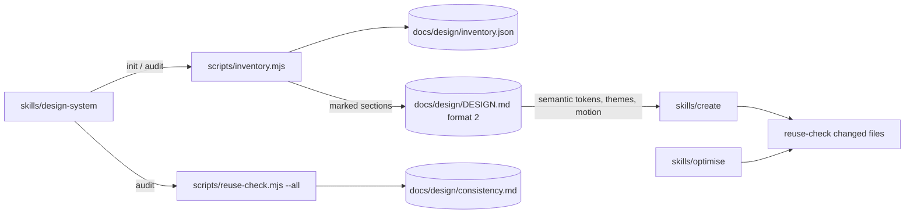
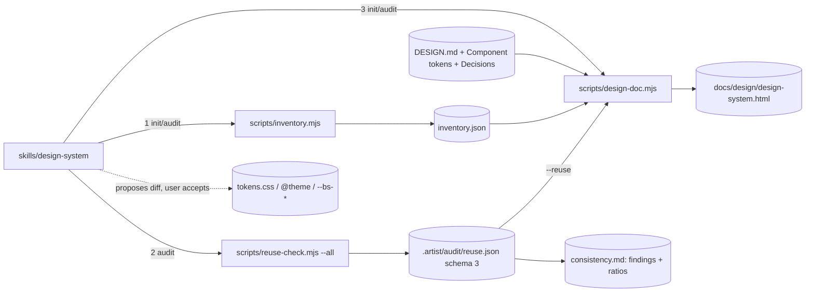
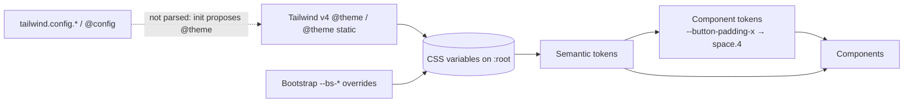

> **Human reference.** The loop never reads this file. What it enforces lives in
> [`plugin.rules.md`](./plugin.rules.md); if the two disagree, the rules file wins
> and `/architect --update plugin` should be run.

# Plugin architecture
_Last verified: 2026-10-25 at `88d9255` · Source ideas: [artist-ui-plugin](../ideas/artist-ui-plugin.md), [design-doc-uniformity](../ideas/design-doc-uniformity.md)_

## In plain English
Artist is a Claude Code plugin that designs, builds and polishes UI for web
(React/Next.js/Tailwind) and mobile (Expo/React Native) projects. It differs from
using Anthropic's `frontend-design` skill plus Playwright on their own in three
ways:
- **A project design system.** It records one in `docs/design/DESIGN.md`.
- **It refines.** It renders what it built, has an isolated critic score the
  screenshots against a fixed eight-point rubric, and refines until every score
  is at least 4/5 (at most 3 rounds).
- **It measures.** Accessibility and Core Web Vitals come from a deterministic
  script, not from the model's impression.

It is made only of skills and one read-only agent, with no hooks. It runs on its
own and inside craftsman projects without tripping craftsman's guards.

## How it fits

## Decisions
| id | decision | why | rejected alternatives |
|---|---|---|---|
| ARCH-PLUGIN-01 | Skills only, no `commands/` | official guidance prefers skills for new plugins | flat commands |
| ARCH-PLUGIN-02 | No hooks in v1 | cannot collide with craftsman's PreToolUse/PostToolUse guards | format/lint hooks |
| ARCH-PLUGIN-03 | No dependency on craftsman | owner requirement: independent | declare `dependencies` |
| ARCH-PLUGIN-04/05 | Two pinned MCPs, headless, isolated, telemetry off | owner chose thin core; supply-chain and token cost | bundling all 16 |
| ARCH-PLUGIN-06 | Keys only via sensitive `userConfig` | keeps secrets out of files | env vars in `.mcp.json` |
| ARCH-PLUGIN-07/08 | Four workflow skills plus web/mobile reference packs | owner chose web and mobile from day one; packs load only when needed | one giant skill; separate mobile plugin |
| ARCH-PLUGIN-09/10/11 | Isolated read-only critic, one per round, NOT ISOLATED fallback | reduces self-grading bias; passes craftsman's guard via a `builtinAgents` line | in-session self-critique |
| ARCH-PLUGIN-12/24 | Fixed 8-dimension rubric; stop at all ≥4 + axe 0 serious + LCP ≤2.5 s + CLS ≤0.1 + 0 unjustified new components/layouts/colours, max 3 rounds (24 supersedes 13) | owner chose this bar; turns "great" into something checkable | avg ≥4.5 with 5 rounds; avg ≥3.5 with 2 rounds |
| ARCH-PLUGIN-14/22 | `design-system` is sole writer of DESIGN.md, which now inventories Components and Layouts (name, path, use) beside the colour tokens (22 supersedes 15) | one source of truth shared with craftsman's reviewer; reuse needs a list to check against | every skill edits tokens |
| ARCH-PLUGIN-23 | Reuse existing components, layouts, colours and installed npm packages (e.g. chart.js) wherever they fit; anything new, including a new dependency, needs a one-line justification (23 supersedes 16) | owner asked that the AI use what exists, within reason; the justification is the "within reason" | prose instructions plus critic only; advisory-only check |
| ARCH-PLUGIN-17 | Page content is untrusted data | prompt-injection via rendered pages | — |
| ARCH-PLUGIN-18 | `optimise` limited to measured perf/a11y plus UI-level security smells | craftsman already has security/dependency auditors | a second security auditor |
| ARCH-PLUGIN-19 | Own marketplace in this repo | independence from craftsman releases | add to craftsman-marketplace |
| ARCH-PLUGIN-20 | `validate --strict` plus evals per skill | catches manifest drift; regression net | manual testing |
| ARCH-PLUGIN-21 | Other 7 integrations as README snippets | opt-in per project, nothing runs by default | bundling |

## Data & flows

**Cross-repo work (craftsman, planned as a separate project step):**
`agents/ui-ux-reviewer.md` and `skills/design-review/SKILL.md` load
`docs/design/DESIGN.md` when present. `EXTENDING.md` documents adding
`"artist:design-critic"` to `execution.builtinAgents`. No guard code changes.

## Trade-offs & known limits
- **Mobile verification.** The browser only sees mobile screens through Expo web.
  Native-only screens get guidance and critique of manual screenshots, not
  measurements.
- **Cost per page.** Three rounds roughly triples the cost of a single pass.
  Revisit the cap if pages routinely need all three.
- **Pinned MCPs drift stale.** Bump them deliberately, with an eval run.
- **Critic in craftsman projects.** It needs one config line there. Without it,
  rounds run NOT ISOLATED.

## Glossary
- **Round**: one build → measure → critique pass.
- **NOT ISOLATED**: the critique ran in the building session, not a fresh agent.
- **CWV**: Core Web Vitals (LCP, CLS).
- **Token**: a named design value (colour, size, spacing) in DESIGN.md.

## Amendment 2026-10-25: design depth, white-labelling, consistency, motion
Asked for after the first build: artist should know and maintain every component, layout and schema, use colours as variables so a product can be re-branded, keep one consistent design across the platform, and treat animation as part of the design.

| id | decision | why | rejected alternatives |
|---|---|---|---|
| ARCH-PLUGIN-25 (supersedes 22) | DESIGN.md format 2: primitives, semantic tokens mapped to CSS variables, one or more brand themes (light and dark), motion tokens, and generated Components / Layouts / Schemas / Packages sections | white-labelling is a theme swap; the inventory is generated so it cannot drift | literal tokens only; one brand only; hand-maintained inventory |
| ARCH-PLUGIN-26 (supersedes 23) | Reuse components, layouts, schemas, semantic tokens and installed packages; colours, spacing and motion only through tokens outside the definition files | a hard-coded value that equals today's brand colour breaks the next re-brand | allowing literals that match a token |
| ARCH-PLUGIN-27 | design-system runs inventory.mjs on init and audit; audit runs reuse-check --all and writes docs/design/consistency.md | keeps the whole platform consistent, not just the files a run touched | changed files only |
| ARCH-PLUGIN-28 | Animated components use motion tokens and a reduced-motion fallback | animation is a design decision and an accessibility requirement | guidance only; video capture of motion |

**Trade-off:** strict literal checks will flag existing code on the first `audit`. That is the point of the consistency report, and each item can be fixed or justified.

## Amendment 2026-10-25: design doc, decisions, variables-first, uniformity ratios
Source: [design-doc-uniformity](../ideas/design-doc-uniformity.md). The owner asked for a browsable design doc of every UI decision, a record of *why* each choice was made, a token model where one variable change restyles the whole product (Tailwind's single-source `@theme` plus Bootstrap's per-component variables, as patterns, not dependencies), and a measure of how uniform the UI is.

| id | decision | why | rejected alternatives |
|---|---|---|---|
| ARCH-PLUGIN-29 (supersedes 25) | DESIGN.md stays format 2 and gains two optional sections: Component tokens (Bootstrap-style, only for components with variants or brand overrides, each aliasing a semantic token) and Decisions (`id, decision, why, date, supersedes`). On-scale Tailwind v4 spacing multiples count as token use; breakpoints remain literal | additive, so no project has to re-run init; restyle one component without touching others; rationale stops "fixes" to deliberate choices | format 3 (forces every project through the rerun path); a component token for every component (variable bloat); only named spacing tokens conform (nearly every Tailwind project fails) |
| ARCH-PLUGIN-30 (supersedes 27) | init and audit also regenerate the HTML doc; audit's consistency.md shows a four-number ratio per category beside the findings | the team doc can't drift silently; counts mean something only with a denominator | HTML on demand only; counts without totals |
| ARCH-PLUGIN-31 | Only design-system (via design-doc.mjs) writes the committed `docs/design/design-system.html`; no live-tweak panel yet | same single-writer rule as DESIGN.md; a JS-free page has the smallest injection surface | gitignored `.artist/design/` output; live-tweak panel in slice 1 |
| ARCH-PLUGIN-32 (superseded by 38) | init proposes token-file diffs and applies them only on acceptance; nothing ever executes project config | owner wants variables everywhere without the plugin silently editing code; executing `tailwind.config.js` would run untrusted code | init owns and regenerates token files; document only |
| ARCH-PLUGIN-33 | Decisions proposed by init with evidence, confirmed by the user, append-only via `supersedes`; deprecations worded `Deprecate <Name>` | ADR-style history; inventory's existing deprecation scan reads these rows, so the wording makes it intentional | human-written only; excluding Decisions from the deprecation scan |
| ARCH-PLUGIN-34 | Ratios never gate `create`, never reach the critic, never blend into one score; justified ≠ conforming | Goodhart: a single gameable number distorts the loop | one 0–100 score; ratios as a stop criterion |

**Trade-offs:**
- Tailwind v3 (JS config) projects are not supported as a token source; init points them to `@theme` (see the deep-review amendment below).
- The committed HTML changes whenever the inventory changes. That is by design, because it is deterministic and has no timestamp churn.
- Whether teammates actually open the HTML is unproven. If nobody uses it within a month, stop committing it (the idea's kill criterion).

**Rollout:** three slices, each revertible on its own:
1. HTML doc + Decisions.
2. Token resolver, Component tokens and init's proposal step. A half-day spike first checks whether a `var()`-only reference makes Tailwind emit a theme variable; `@theme static` is the safe default either way.
3. Ratios and `reuse.json` schema 3.

The plugin version goes to 0.2.0.

## Amendment 2026-10-25 (deep review): Tailwind v4 only, strict component tokens, testable checks
Source: an isolated `/architect --deep` review of the design-doc-uniformity rules against the code, plus four owner decisions. It supersedes ARCH-PLUGIN-29..34 with 35..40 and adds 41. Intent is unchanged; the edits remove v3, settle what the review found ambiguous, and make each `check:` mechanical.

| id | decision | why | rejected alternatives |
|---|---|---|---|
| ARCH-PLUGIN-35 (supersedes 29) | Type scale, Spacing and Motion may carry an optional `variable` column (else bound by naming convention). Every component with variants needs a Component tokens block, and a missing block counts `unjustified` in its ratio. Numeric spacing counts only for `p*`/`m*`/`gap*`/`space-x\|y` | owner wants every variant component restyleable by variable; "MAY" alone left a variant component with no block neither conforming nor failing | required `variable` column (forces every DESIGN.md to migrate); counting only existing blocks (a project with none shows 0/0) |
| ARCH-PLUGIN-36 (supersedes 30) | design-doc runs once per mode: after inventory on init, after consistency.md with `--reuse` on audit | the old wording read as two runs on audit | rendering twice |
| ARCH-PLUGIN-37 (supersedes 31) | the HTML has no `<script>` element at all and carries a strict CSP meta | "no script that mutates styles" could not be checked mechanically; a CSP adds defence in depth at no cost from `file://` | allowing non-mutating scripts |
| ARCH-PLUGIN-38 (supersedes 32) | Tailwind is v4 CSS-first only. init proposes semantic tokens in `@theme static`, so aliased variables always exist. A JS config or `@config` gets a "not parsed, use `@theme`" note | owner decision; v4 does not auto-load JS configs (tailwindcss.com/docs/upgrade-guide); only used variables are emitted unless `static` (tailwindcss.com/docs/theme) | static parse of v3 `theme.extend`; relying on `var()` counting as a use (unverified) |
| ARCH-PLUGIN-39 (supersedes 33) | `Deprecate <Name>` must be the exact decision cell; init converts prose deprecations into such rows | the old scan matched any line containing "deprecated" and a component name (`inventory.mjs:90`), so "Modal is deprecated in favour of Dialog" deprecated both | keeping the loose prose scan |
| ARCH-PLUGIN-40 (supersedes 34) | adds that advisory lists are never counted; the HTML shows ratios only when `--reuse` was given | init has no reuse.json, so the old check was untestable on init | — |
| ARCH-PLUGIN-41 | the skills, template and eval describe Tailwind only as v4 `@theme` | `skills/create/references/web.md:11` and `evals/design-system/prompt.md:7` still teach a v3 JS config | keeping v3 examples as "also works" |

**Trade-offs:**
- Strict component tokens will show many `unjustified` items on the first audit of an existing project. That is intended; each can be fixed or justified.
- Dropping the prose deprecation scan changes behaviour for existing DESIGN.md files. init's proposed `Deprecate` rows are what keep this from being silent.
