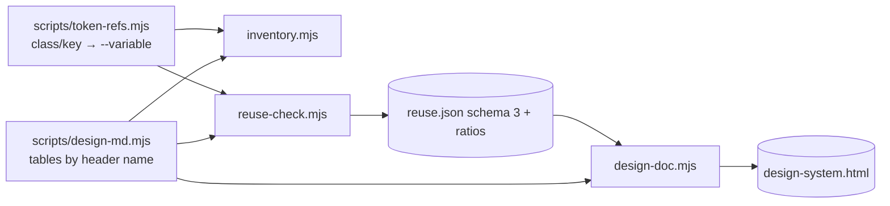
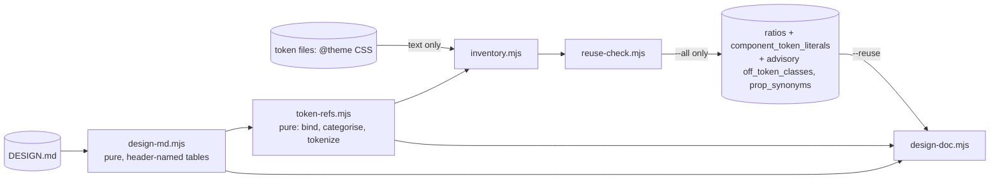

> **Human reference.** The loop never reads this file. What it enforces lives in
> [`verify.rules.md`](./verify.rules.md); if the two disagree, the rules file wins
> and `/architect --update verify` should be run.

# Verify architecture
_Last verified: 2026-10-25 at `88d9255` · Source ideas: [artist-ui-plugin](../ideas/artist-ui-plugin.md), [design-doc-uniformity](../ideas/design-doc-uniformity.md)_

## In plain English
`scripts/verify.mjs` is the one place artist's numbers come from. Given a local
URL, it:
1. opens the page headless at 375, 768 and 1280 px and takes screenshots;
2. runs axe-core for accessibility violations;
3. measures LCP and CLS three times and takes the median;
4. writes `report.json` and a self-contained `review.html` into
   `.artist/runs/<timestamp>/`.

The model reads the report. It never estimates the numbers itself. The two MCP
servers are for digging into why a check failed.

## How it fits
```mermaid
flowchart LR
  SK[create / verify / optimise skills] -->|node verify.mjs URL| V[scripts/verify.mjs]
  V -->|first run installs into| PD[(CLAUDE_PLUGIN_DATA/node_modules)]
  V --> PW[playwright chromium headless]
  PW --> AX[@axe-core/playwright]
  PW --> WV[web-vitals injected]
  V --> R[(.artist/runs/ts/)]
  R --> J[report.json schema 1]
  R --> P[375.png · 768.png · 1280.png]
  R --> H[review.html offline]
```

## Decisions
| id | decision | why | rejected alternatives |
|---|---|---|---|
| ARCH-VERIFY-01 | Script is the only source of reported scores | repeatable, cheap on tokens | MCP-only measurement |
| ARCH-VERIFY-02 | Versioned `report.json` schema | critic, review page and future craftsman use read one shape | ad-hoc text |
| ARCH-VERIFY-03 | 375/768/1280 default breakpoints | phone, tablet, laptop | single viewport |
| ARCH-VERIFY-04 | Loopback-only unless `--allow-remote` | Playwright's origin lists are not a security boundary | trust the URL |
| ARCH-VERIFY-05 | Pinned deps in CLAUDE_PLUGIN_DATA | never pollute the target project; survives plugin updates | install into project |
| ARCH-VERIFY-06 | Output only under `.artist/runs/` | no stray files in source | write beside components |
| ARCH-VERIFY-14 | 3 runs, median; unstable only when LCP spread is >20% AND >100 ms (supersedes 07, owner-approved 2026-10-25) | catches real jitter; a fast local page (28 ms LCP) showed 57% relative spread from millisecond noise, so pure-relative failed every fast page | pure 20% (07); 20% and >250 ms |
| ARCH-VERIFY-08 | Exit 0/1/2; crash ≠ pass | fail closed | treat crash as skip |
| ARCH-VERIFY-17/10 | Offline `review.html` with slider, scores, axe, CWV, token diff and reuse findings, written once by `create` at its Finish step via review-html.mjs (17 supersedes 13, which superseded 09) | owner wants to see every change visually | terminal only; published artifact |
| ARCH-VERIFY-12 | Deterministic `reuse-check.mjs` → `reuse.json`; blocks on unjustified new components, layouts, raw colours or dependencies, and marks a new package that duplicates an installed one's capability | owner chose a script check over model judgement, and blocking over advisory | instructions + critic only; advisory |
| ARCH-VERIFY-11 | Node ESM plus `node --test` | matches craftsman | another runtime |

## Data & flows
Runs are append-only folders. Nothing is deleted automatically; `.artist/` should
be gitignored in target projects (the `design-system init` skill offers to add it).

## Trade-offs & known limits
- **Lab metrics only.** LCP and CLS are lab metrics. INP needs real interaction,
  so it is out of scope for v1.
- **Startup cost.** The first run installs Chromium-compatible Playwright, roughly
  150 MB in `CLAUDE_PLUGIN_DATA`.

## Glossary
- **Loopback**: localhost addresses only.
- **Median of 3**: the middle value of three measurements.

## Amendment 2026-10-25: inventory and whole-project consistency

| id | decision | why | rejected alternatives |
|---|---|---|---|
| ARCH-VERIFY-15 (supersedes 12) | reuse-check schema 2: also flags every colour literal outside the token/theme files, off-scale spacing, raw durations/easings, missing reduced-motion fallbacks; `--all` scans the whole project and adds stale inventory entries and near-duplicate components (same name, or ≥2 meaningful props with ≥80% overlap); `docs/design/**` is never scanned | one deterministic tool enforces one consistent, re-brandable design | model-judged audit; changed files only |
| ARCH-VERIFY-16 | inventory.mjs writes docs/design/inventory.json (components with props, variants, tokens used, usage, status; layouts with routes; zod/yup/JSON Schema/TS schemas; packages) and regenerates DESIGN.md's marked sections | deep, current knowledge of what exists, readable in DESIGN.md and exact in JSON | hand-maintained tables |

**Known limit:** prop and schema extraction is static (regex and light parsing, no TypeScript compiler), so unusual patterns may be missed; the inventory marks what it could not parse.

## Amendment 2026-10-25: uniformity ratios, token resolution, design-doc renderer
Source: [design-doc-uniformity](../ideas/design-doc-uniformity.md).



| id | decision | why | rejected alternatives |
|---|---|---|---|
| ARCH-VERIFY-18 (supersedes 01) | Page scores come from verify.mjs; consistency findings and ratios come from reuse-check.mjs; skills never compute numbers | keeps every number reproducible by a script, now that audit reports ratios | ratios labelled "counts" outside the rule; skill-computed figures |
| ARCH-VERIFY-19 (supersedes 15) | reuse.json schema 3 adds per-category `{conforming, justified, unjustified, total}` counted per site, `component_token_literals[]` and advisory `off_token_classes[]`; a justification never makes an item conforming | per-site matches how findings are reported (`file:line`); off-token Tailwind classes inform without breaking existing create loops | additive under schema 2; per-file counting; blocking default-palette classes |
| ARCH-VERIFY-20 (supersedes 16) | tokensUsed also resolves Tailwind classes by namespace from the Semantic tokens `variable` column and RN theme keys by exact token name; config is never executed | today a Tailwind `bg-brand` button records no token use (`inventory.mjs:164`); v4 maps `--color-brand` to `bg-brand` by definition | importing `tailwind.config.js`; counting any `theme.*` chain |
| ARCH-VERIFY-21 | design-doc.mjs is deterministic, self-contained, escapes everything, allowlists swatch values, embeds an input hash and supports `--check`; it validates Decisions ids | committed file must not churn or carry stored XSS; audit can flag a stale doc | `generated_at` timestamp; JS-applied swatches |

**Shared helpers:** `design-md.mjs` (one DESIGN.md parser, by header name, which also fixes the fixture-vs-template Themes header mismatch) and `token-refs.mjs` (pure resolver with its own tests).

**Known limits:**
- Site counting is regex-based, so CSS-in-JS, Vue/Svelte SFCs and vendored CSS can be miscounted. Every ratio reports `total`, so readers can sanity-check it.
- Tailwind v3 JS configs are never parsed (v4 CSS-first only, ARCH-PLUGIN-38).

## Amendment 2026-10-25 (deep review): counting units, binding, the class tokenizer
Supersedes ARCH-VERIFY-19..21 with 22..24 and adds 25..27, after an isolated review traced the rules against `reuse-check.mjs`, `inventory.mjs` and the Tailwind v4 docs.



| id | decision | why | rejected alternatives |
|---|---|---|---|
| ARCH-VERIFY-22 (supersedes 18) | Ratios and the new lists exist only with `--all`. A site is a unique `(file, token-or-value)` pair. A missing block for a variant component counts `unjustified`. component_api: the most common value set per shared prop is canonical, and synonyms are listed as advisory hints. New item names are `<Component>.<prop>` | existing findings already dedupe per `(file, value)` (`reuse-check.mjs:193-198`), so the sum invariant needs the same unit; in default mode `component_token_literals` would leak into the create loop's `unjustified`; `justify()` keys on `name` (`reuse-check.mjs:55`), so a bare `Button` would collide with `new_components` | per-occurrence counting (changes schema-2 arrays); synonyms counted in the ratio (a judgement call inside the number) |
| ARCH-VERIFY-23 (supersedes 19) | `tokensUsed` is normalised to each token's bound variable; the declared token files are read as text; deprecation comes only from JSDoc or an exact `Deprecate <Name>` row | `inventory.mjs:311` reads only ts/js/json, so it never sees `--spacing`; the prose scan misfires (`inventory.mjs:90`) | executing config; keeping the prose scan |
| ARCH-VERIFY-24 (supersedes 20) | the input manifest (paths + sha256 + renderer version) makes `--check` reproducible whichever mode wrote the file; `supersedes` is rendered as text | a bare hash can't tell init-rendered from audit-rendered inputs; an anchor would be an href derived from data | timestamp; in-page anchors |
| ARCH-VERIFY-25 | `design-md.mjs` owns `formatOf` and table parsing (re-exported from inventory); it and token-refs are pure; design-doc never imports reuse-check | reuse-check imports inventory and git plumbing (`reuse-check.mjs:7`); one parser fixes the fixture-vs-template Themes mismatch (`scripts/fixtures/reuse/DESIGN.md:24-28` vs `design-template.md:36`) | parsing inside each script; design-doc importing reuse-check |
| ARCH-VERIFY-26 | binding is the `variable` cell or the convention `space.4` → `--space-4`; category comes from value shape; `--spacing` is read statically (default 0.25rem) | matches what already holds (`color.action.primary` ↔ `--color-action-primary`); numeric utilities are `calc(var(--spacing) * n)` (tailwindcss.com/docs/padding) | a required column; a `category` column; a `spacing base` Platform-notes line |
| ARCH-VERIFY-27 | the class tokenizer tracks bracket depth and handles `!`, `-`, `/opacity`, `x-(--v)` and `x-[…]`; unknown or ambiguous classes are advisory | variants can contain `:` (tailwindcss.com/docs/hover-focus-and-other-states), so today's split on `:` (`reuse-check.mjs:77`) breaks them | splitting on `:`; preferring colour when `text-foo` is ambiguous |

**Known limits:**
- rem is fixed at 16px (`reuse-check.mjs:62`).
- The component_api canonical set can shift when a new component changes the majority. That is deterministic for a given tree, but can move between audits.

_Renumbered 2026-10-25 when main merged in: main's `/architect --update` (eb5b86d) had already taken ARCH-VERIFY-17 (create writes review.html once, at Finish), so this amendment's rules moved from 17..26 to 18..27 with no change in meaning; ARCH-VERIFY-22 now spells out the scan scope that main added to ARCH-VERIFY-15._
